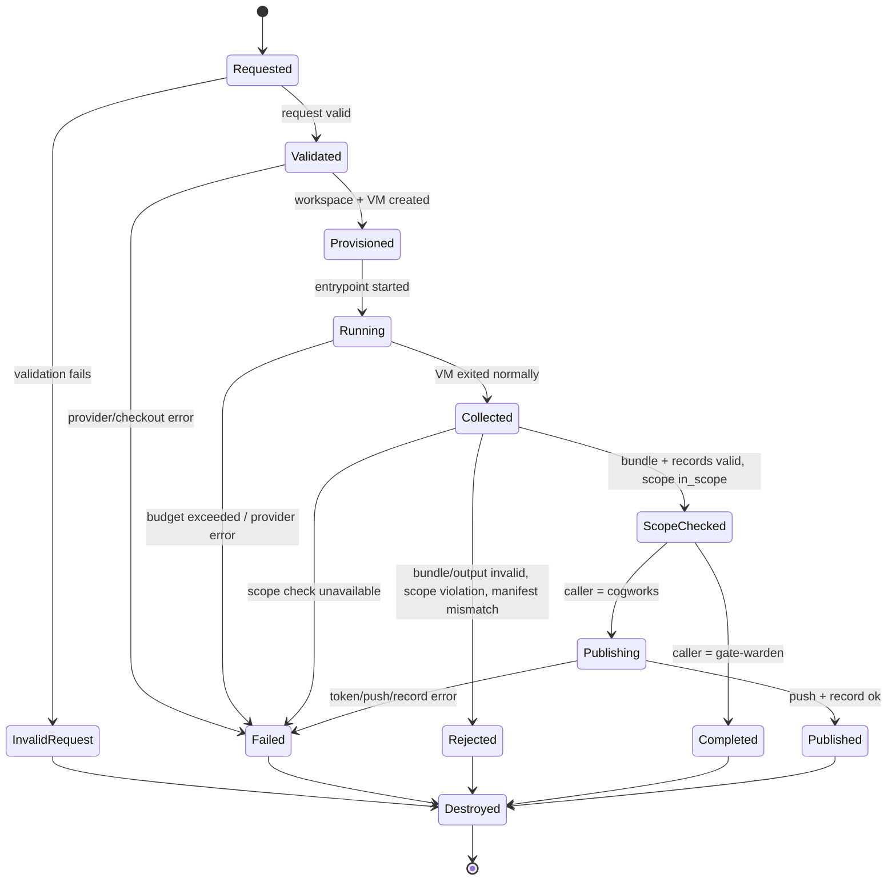
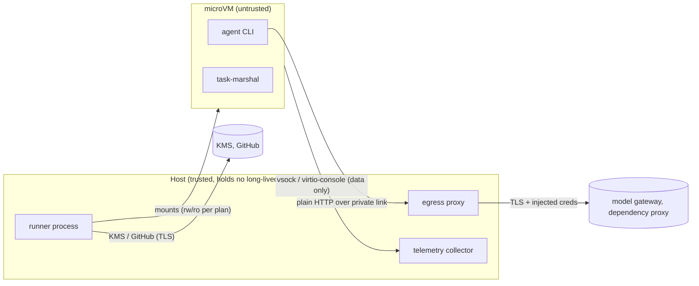

# Architecture

The design follows clean-architecture layering. Domain logic is pure and depends only on
the ports (traits) defined below. Infrastructure adapters implement those ports. Only
infrastructure adapters handle secrets, the hypervisor, the network and GitHub.

## Business logic

### Attempt lifecycle state machine

Rules:

1. **Totality.** Every state has a defined transition for every step outcome. A panic is
   never a transition.
2. **Teardown always happens.** Every terminal outcome passes through `Destroyed`. Teardown
   runs even if a later step panics or the process is cancelled (a guard plus the startup orphan
   sweep).
3. **The VM is stopped before collection.** Results are read only after the VM has stopped, so
   the VM cannot change them while they are inspected.
4. **Publishing is ordered.** The commits are pushed first and the output record is written
   second. Both steps are idempotent and keyed by `attempt_id`.
5. **The mode comes from the caller.** In `gate-warden` mode the attempt never enters
   `Publishing`.
6. **Classifying results is pure.** Mapping (step outcome, state) to (next state, ReasonCode)
   is a pure function. It is property-tested (see [testing.md](testing.md)).

### Domain policies

- Request validation rules (see [interfaces.md](interfaces.md)).
- Mount-plan normalisation and effective-access computation.
- Composing the egress allowlist from the network profile and the extras declared in the stage contract.
- Budget evaluation.
- Bundle acceptance: ancestry, size and object-type limits.
- The comparison rule for oracle manifests.

## External system interfaces (ports)

| Port | Purpose | L1 adapter |
| --- | --- | --- |
| `SandboxProvider` | Create/start/wait/kill/destroy VM; report usage; expose telemetry channel | microsandbox (libkrun) |
| `MountPlanSource` | Fetch mount plan for (repo, role, stage) | agent-gate (library or CLI) **[EXT]** |
| `ScopeCheck` | Verify commit range against role + plan | agent-gate |
| `GitRemote` | Fetch at SHA; verify bundle; push refs | git CLI / gitoxide-based adapter |
| `GitHubApi` | Write output-record comment | GitHub REST |
| `TokenIssuer` | Role-scoped installation token | KMS-backed GitHub App adapter (Vault or any KMS) |
| `Signer` | Sign oracle manifest with role key | KMS adapter |
| `SecretSource` | Resolve credential references (proxy only) | Vault / KMS adapter |
| `EgressPolicySink` | Install/remove per-attempt allowlist in the proxy | Local proxy control API |
| `OutputSchemaSource` | Fetch output schema at pinned revision | Harness repository reader |
| `TelemetryExporter` | Spans, metrics, logs | OTLP exporter |
| `Clock` | Time for budgets and timestamps | System clock (fake in tests) |
| `ConfigProvider` | Host limits, branch patterns, role mappings | File + env (no secrets in env) |

## Infrastructure implementations

- **microsandbox provider:** runs libkrun microVMs. It maps the read-only root filesystem, the virtiofs mounts
  for each mount-plan entry, the network attachment that only reaches the proxy, and a vsock or
  virtio-console telemetry channel.
- **Egress proxy:** a separate host process with its own network namespace. It enforces the allowlist and
  injects credentials (see [egress.md](egress.md)).
- **KMS adapters:**
  - a Vault adapter first;
  - an adapter for any KMS that has a signing API;
  - workload identity through any OIDC provider.
- **GitHub App adapter:** issues tokens per role, pushes, and writes comments.
- **OTel exporter:** exports traces, metrics and logs over OTLP (see [observability.md](observability.md)).
- **Reaper:** a host-side sweeper.

## Trust boundaries

- Everything that crosses from the VM to the host is **data**: files in the output area, telemetry
  frames, and HTTP requests to the proxy. The host parses it with strict limits and never executes it.
- Secrets exist only in host memory, inside the `TokenIssuer`, `Signer` and `SecretSource`
  adapters and the proxy.

## Dependency rule

The domain crates depend on no infrastructure crates. CI enforces this through workspace
dependency checks (see [constraints.md](constraints.md)).

## Gate-warden mode

gate-warden mode has the same lifecycle with three differences:

- the mount plan is usually all read-only, except for an output area;
- the network profile is usually limited to the dependency proxy;
- nothing is pushed.

gate-warden receives the AttemptResult and publishes its own verdict under its own GitHub
App identity.
