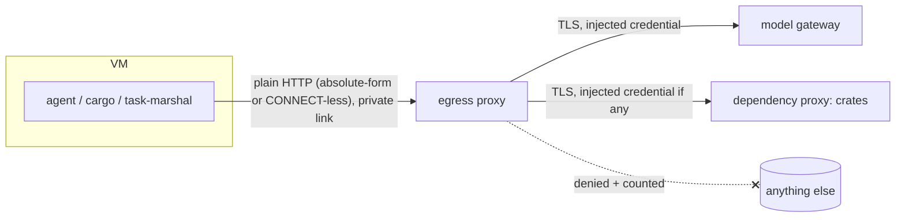

# Egress

## Principles

- **Deny by default.** The VM's only network attachment reaches the egress proxy over a
  private link. There is no default route, no other DNS server, no IPv6 route, and no path to host
  services or to cloud metadata endpoints.
- **Allowlist per attempt.** For each attempt the allowlist is the network profile plus any extras declared
  in the stage contract. Extras that the stage contract does not declare are rejected at validation.
- **Credentials are injected by the proxy.** The VM never holds credentials for any endpoint.

## Topology

- **Traffic from the VM.** The VM talks plain HTTP to the proxy over a private link: a per-VM virtual
  interface or vsock, depending on the provider. The proxy then opens TLS to the upstream itself.
  This means the VM needs no MITM CA, and credentials never cross into the VM
  ([ADR-0005](../adr/ADR-0005-egress-proxy-credential-injection.md)).
- **Name resolution.** Clients in the VM address virtual hostnames, for example
  `http://model-gateway.egress.internal`. The proxy maps these to real upstream URLs. The VM resolves no
  names itself: it has no DNS resolver, or only a resolver that answers for the virtual names.
- **CONNECT tunnelling is not offered.** Anything that is not plain HTTP to a known virtual host is
  denied.

## Allowlist model (extensible)

Each `EgressRule` holds:

| Field | Meaning |
| --- | --- |
| `destination_kind` | `model_gateway` \| `package_registry` \| `declared_extra` |
| `ecosystem` | For `package_registry`: `crates` (L1). Reserved: `npm`, `pypi`, `oci`, `go`, `maven`, … |
| `virtual_host` | Name the VM uses |
| `upstream` | Real URL the proxy forwards to |
| `methods` / `path_prefixes` | Optional narrowing (e.g. registries are GET-only) |
| `credential_ref` | Reference resolved by the proxy via `SecretSource`; never a value |
| `rate_limit`, `max_body_bytes` | Abuse limits |

**L1 scope.** The dependency proxy serves **crates only**, which covers the sparse index and crate
downloads. The model is **ecosystem-agnostic**. To add npm, PyPI, OCI or another
ecosystem, you add an `ecosystem` value and a rule template. The proxy, the runner and
the request schema do not change, because `ecosystem` is an open, registry-validated
string rather than a closed enum in the domain. Per-ecosystem client configuration inside
the image (for example `.cargo/config.toml` or `.npmrc`) points at the virtual host and is
supplied by the image or a discipline pack, never by the runner. See
[ADR-0005](../adr/ADR-0005-egress-proxy-credential-injection.md) and
[tradeoffs.md](tradeoffs.md).

**Per-profile extras.** An example is the lore-keeper MCP endpoint. An extra is allowed only if:

- the stage contract declares it;
- the host configuration knows it.

## Credential injection

- **Where credentials come from.** The proxy resolves `credential_ref` through `SecretSource` (Vault or KMS)
  using its own workload identity, and caches the result in memory for at most the credential's TTL.
- **How a request is built.** The proxy strips any `Authorization` or credential-like headers sent by the VM,
  then adds the upstream credential and the correlation headers (`run_key`, `attempt_id`).
- **Response headers.** Upstream response headers that could reflect credentials are stripped before the
  response goes back to the VM, for example `set-cookie` from auth endpoints **[EXTRAP]**.
- **Budgets.** The model gateway enforces token and turn budgets, keyed by `run_key`.

## Observability

Every request produces a log entry with these fields: attempt, virtual host, method, path prefix,
status, bytes, latency and decision (allow or deny). Counters are listed in
[observability.md](observability.md). Denied requests are logged with the destination as
the VM requested it, truncated and escaped.

## Acceptance criteria

- The VM cannot open a TCP or UDP connection to any address other than the proxy. Tested by
  attempting direct IPs, IPv6, and the `169.254.169.254` metadata endpoint.
- No DNS resolution reaches outside the VM. DNS tunnelling attempts fail.
- A request to a non-allowlisted virtual host or upstream is denied and counted.
- Host header or absolute-URI mismatches cannot redirect the proxy to an upstream outside the
  allowlist.
- No credential value appears in the VM's environment, filesystem, proxy responses or logs.
- Adding a new `ecosystem` requires no code change in the domain crates (a configuration-only test).
