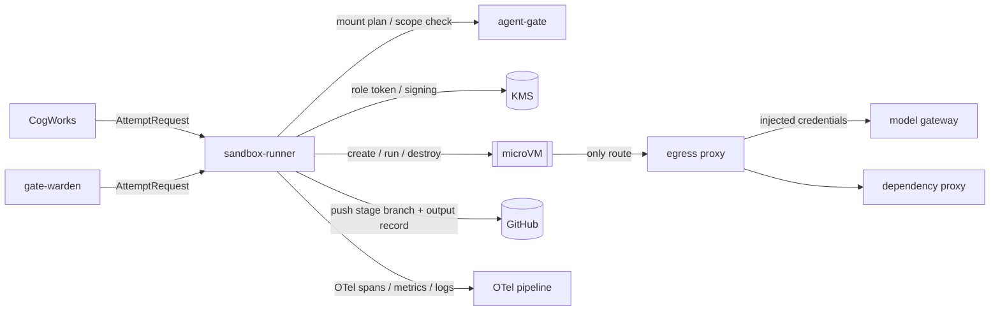

# Overview

## Purpose

sandbox-runner runs exactly **one stage attempt** in a short-lived microVM and then
destroys it. The attempt runs either an agent stage for CogWorks or a check run for
gate-warden. Afterwards the VM, its workspace and every per-attempt cache are gone.

The service is separate from CogWorks so that the deterministic orchestrator never
holds host, virtualisation or push privileges. CogWorks decides *what* runs.
sandbox-runner decides only *how* to run it safely, and turns the result into GitHub
state.

## System context

- **Callers:** CogWorks calls it for agent stages, through CogWorks' provider-neutral runtime
  interface **[EXT: cog-works ADR-0009]**. gate-warden calls it for check runs.
- **Dependencies:**
  - agent-gate, for mount plans and the commit-range scope check.
  - The KMS, for role tokens and signing.
  - The model gateway and the dependency proxy. These are the only egress targets.
- **Outputs:** results via GitHub (the pushed stage branch plus an output record), and
  telemetry to the OTel pipeline. The OTel pipeline is provided by chain-chronicler at its
  L2, so in L1 the target is any OTLP endpoint.

## Goals (L1)

1. **Accept requests.** Accept a validated attempt request covering image, repository + SHA, context bundle,
   mount plan, network profile, limits, identity role and output schema location.
2. **Isolate.** Run the attempt on **microsandbox** (libkrun microVM) behind a provider trait. The VM has a
   read-only root filesystem, runs as a non-root user and holds no secrets. task-marshal and the agent
   CLI are present in the image.
3. **Control egress.** Deny everything by default. The proxy allows only the model gateway and the
   dependency proxy, plus any extras declared in the stage contract, and it injects the credentials itself.
4. **Collect results.** Collect the agent's **commits** (as a git bundle), the schema-validated output record and
   any dispute record.
5. **Pre-check scope.** Run agent-gate's scope check before pushing. If it fails, reject the attempt with a
   structured reason.
6. **Push.** Push to the stage branch using a minutes-lived GitHub App installation token for the
   stage's role. Optionally sign the oracle manifest with the oracle role key, outside the VM.
7. **Make completion visible in GitHub.** That means the pushed branch plus an output record (a comment or a
   committed file, as the stage contract says).
8. **Destroy everything.** Destroy the VM, its workspace and its caches on every outcome.
9. **Enforce budgets from outside the VM.** sandbox-runner enforces wall-clock, CPU and memory. Token and turn
   budgets are enforced by the model gateway, keyed by run.
10. **Be observable.** Make both the runner and the processes inside the VM observable (see
    [observability.md](observability.md)).

## Non-goals ("must not")

- Decide which stage or profile runs. CogWorks decides that.
- Decide pass/fail. gate-warden decides that, and it is the only source of required checks.
- Put any secret, token or key inside the VM. This includes telemetry credentials.
- Allow general internet access.
- Keep state beyond the attempt.
- Depend on a specific cloud provider. Hosts may be on-prem, or cloud bare-metal or nested-virtualisation instances.
- Emit queue events in L1. GitHub is the system of record. A queue event may come later as an
  advisory signal only.

## Security posture

This is a control-plane and security-boundary repository, so it is treated as **T2+**
whoever builds it. Every PR gets a human review, and gate configuration is read from the
default branch.

## Increments

| Level | Milestone | Content |
| --- | --- | --- |
| L1 | M1 (human-led) | Everything in this spec unless marked L2 |
| L2 | M6 (factory-built) | Second provider (Firecracker or Kata), pre-warmed images, read-only dependency caches, KVM host pool |

See [roadmap.md](roadmap.md).
