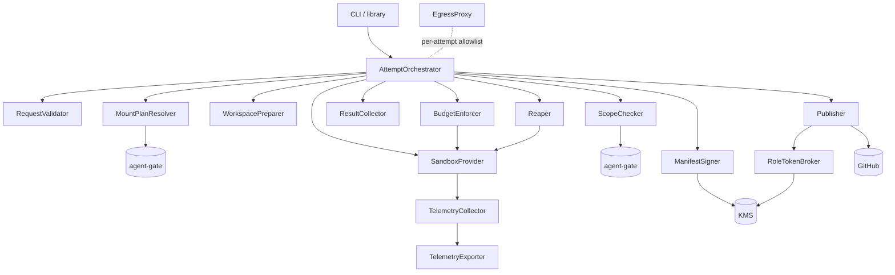

# Responsibilities (CRC)

Each component has a CRC card. "Knows" lists the state or information it owns. "Does"
lists its behaviour. "Must not" restates the guarantees each component is responsible
for. Concrete names are left to the interface designer.

## AttemptOrchestrator (domain)
- **Knows:** the attempt's state, request, timestamps and accumulated result; the
  allowed state transitions.
- **Does:**
  - drives the lifecycle state machine;
  - decides the next step from the current state and the outcome of the previous step;
  - guarantees that teardown runs on every path;
  - turns failures into a `ReasonCode`.
- **Collaborators:** every port listed below.
- **Roles:** coordinator, policy holder for the lifecycle.
- **Must not:** decide pass/fail; choose a stage or profile; touch secrets directly.

## RequestValidator (domain)
- **Knows:** the request schema version; host configuration maximums; the stage-branch pattern.
- **Does:**
  - validates the request against the schema;
  - checks the semantic rules: image pinned by digest, limits within maximums, the mode rules for each caller,
    a safe mount-plan default, and a branch that is neither protected nor the default branch.
- **Collaborators:** ConfigProvider.
- **Roles:** gatekeeper.

## MountPlanResolver (domain + port)
- **Knows:** the rules for normalising mount plans.
- **Does:**
  - obtains the mount plan from agent-gate when the request carries a reference, or validates it when the plan
    is inline;
  - normalises paths;
  - computes the effective access for every path in the checkout.
- **Collaborators:** MountPlanSource (agent-gate adapter).
- **Must not:** widen access beyond the plan.

## WorkspacePreparer (infrastructure behind a port)
- **Knows:** the workspace root for the attempt.
- **Does:**
  - fetches `repository@checkout_sha` with read-only, credential-scoped access, outside the VM;
  - applies the effective mount plan: read-write, read-only or absent per path, plus uid/gid ownership;
  - mounts the context bundle read-only;
  - creates the output area.
- **Collaborators:** GitRemote, SandboxProvider.
- **Must not:** leave git credentials in the workspace.

## SandboxProvider (port) / MicrosandboxProvider (adapter)
- **Knows:** provider capabilities; how to map limits, mounts and networking onto the backend.
- **Does:**
  - creates a VM from a pinned image with a read-only root filesystem, a non-root user, the workspace mounts, a
    network attachment to the proxy only, and a telemetry channel;
  - starts the entrypoint;
  - waits for the VM to exit;
  - enforces the CPU and memory limits;
  - kills the VM;
  - destroys the VM;
  - reports actual resource usage.
- **Collaborators:** BudgetEnforcer, TelemetryCollector.
- **Roles:** isolation boundary.

## EgressProxy (infrastructure; separate process)
- **Knows:** the effective allowlist for each attempt; how credential references map to the secret source.
- **Does:**
  - accepts plain HTTP from the VM over a private link;
  - matches each request against the allowlist;
  - opens TLS upstream;
  - injects credentials for the destination;
  - adds correlation headers;
  - counts and logs both allowed and denied requests.
- **Collaborators:** SecretSource (KMS/Vault), TelemetryExporter.
- **Must not:** forward to any destination outside the allowlist; return credentials to the VM.

## BudgetEnforcer (domain policy + host watchdog)
- **Knows:** the attempt's limits and its start time.
- **Does:** watches the wall-clock limit and kills the VM through the provider when it is exceeded; records
  CPU and memory limit events reported by the provider.
- **Collaborators:** SandboxProvider, Clock.

## TelemetryCollector / LogRelay (infrastructure, host side)
- **Knows:** the per-attempt telemetry channel; size and rate caps; redaction rules.
- **Does:**
  - receives in-VM stdout/stderr, process events, task-marshal and agent-CLI events, and resource samples
    over the host-owned channel (vsock or virtio-console);
  - frames each item and tags it with host-side correlation and a source tag of `in_vm` (untrusted);
  - enforces the size and rate limits;
  - redacts;
  - forwards items to the TelemetryExporter and to the live-tail stream;
  - writes the bounded attempt log archive before teardown.
- **Collaborators:** SandboxProvider, TelemetryExporter, ResultCollector (for the log reference).
- **Must not:** let in-VM content set host-side fields such as severity, outcome, span status or
  correlation IDs.

## ResultCollector (domain + adapter)
- **Knows:** the result locations in the output area; size caps.
- **Does:**
  - extracts the CommitBundle, the OutputRecord, the DisputeRecord and, if present, the OracleManifest from
    the output area after the VM has stopped;
  - verifies the bundle's ancestry and its object limits;
  - validates the output record against the schema.
- **Collaborators:** OutputSchemaSource, GitRemote (local bundle verification).
- **Must not:** execute anything produced by the VM.

## ScopeChecker (port) / agent-gate adapter
- **Does:** submits the commit range, role and mount plan to agent-gate and returns the ScopeVerdict. It fails
  closed.
- **Collaborators:** agent-gate.

## ManifestSigner (port) / KMS adapter
- **Does:**
  - recomputes the oracle manifest digests from the collected tree;
  - compares them with the manifest produced in the VM;
  - asks the KMS to sign with the oracle role key only if they match.
- **Must not:** sign anything it has not recomputed.

## RoleTokenBroker (port) / KMS + GitHub App adapter
- **Knows:** the mapping from role to GitHub App installation.
- **Does:**
  - issues a minutes-lived, repository-scoped installation token for the role just before the push;
  - lets the token go out of scope and zeroises it after use.
- **Must not:** expose the token outside the Publisher's call.

## Publisher (domain + GitHub adapter)
- **Does:**
  - in `cogworks` mode, pushes the bundle's commits to the stage branch using the role token (no force push);
  - writes the output record as a comment or committed file, as the stage contract says, idempotently, keyed by
    `attempt_id`;
  - in `gate-warden` mode, does nothing on GitHub.
- **Collaborators:** RoleTokenBroker, GitRemote, GitHubApi.
- **Must not:** create check runs or statuses; force-push; push to protected or default branches.

## Reaper (infrastructure)
- **Does:**
  - destroys the VM, the workspace and the per-attempt caches;
  - confirms that they are gone;
  - at startup and periodically, sweeps orphaned sandboxes and workspaces that belong to no live attempt;
  - quarantines the host if teardown cannot be confirmed.
- **Collaborators:** SandboxProvider, TelemetryExporter.

## TelemetryExporter (port) / OTel adapter
- **Does:** exports host-side spans, metrics and logs, plus relayed in-VM telemetry, to the OTel pipeline,
  with the CorrelationContext attached.
- **Must not:** export secret values.

## Front ends: CLI and library API
- **Does:**
  - accepts an AttemptRequest from a file or stdin, or as a library call;
  - returns the AttemptResult as JSON;
  - offers `tail <attempt_id>` for live viewing.
- **Roles:** the transport for M1. A service mode is to be revisited after cog-works ADR-0009 has been read
  **[EXT]**.

## Collaboration overview

